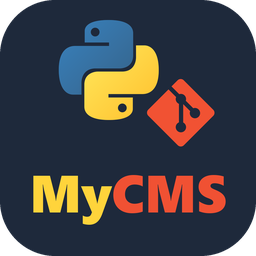

<p align="center">
  
</p>

<h1 align="center">MyCMS</h1>

<p align="center">
  <b>Modifier les textes de son site sans toucher au code.</b><br>
  Un petit CMS local, avec une interface web, pour les sites statiques hébergés sur GitHub Pages :<br>
  on change un texte, on vérifie, on publie, sans HTML ni ligne de commande Git.
</p>

<p align="center">
  
  
  
  
  
</p>

---

## À propos

**MyCMS** s'adresse à la personne qui tient à jour un site statique (des pages HTML dans un dépôt Git, publiées par GitHub Pages) sans être développeuse. Elle ouvre une page, modifie ses textes dans des champs, vérifie le résultat, puis publie en un clic : MyCMS s'occupe du HTML et de Git.

Le développeur du site garde la main sur ce qui est modifiable : seuls les éléments qui ont la classe `editable` apparaissent dans l'éditeur. Le reste de la page (mise en page, menus, style) ne peut pas être cassé par erreur, et chaque sauvegarde ne réécrit que ce qui a changé, à l'octet près.

## Points forts

- **Un éditeur simple** : chaque texte modifiable devient une fiche, avec gras, italique et liens. La recherche ignore accents et majuscules, et des **filtres par catégorie** (déduits de la structure de la page) permettent d'aller directement à la bonne partie.
- **Une sauvegarde fidèle** : seuls les écarts sont réécrits. Le reste du fichier, fins de ligne comprises, est recopié tel quel.
- **Listes, tableaux et images** : ajouter ou supprimer un élément de liste ou une ligne de tableau, remplacer une image, revenir à la version en ligne d'un texte.
- **Un aperçu en direct** : la page s'affiche avec les modifications pas encore sauvegardées, et un clic dans la page ouvre la fiche correspondante.
- **Une publication sûre** : avant chaque envoi, MyCMS vérifie les liens, les images, les adresses e-mail et les numéros de téléphone. Après, il indique quand la modification est visible en ligne. Les conflits avec GitHub sont expliqués simplement, et rien n'est jamais laissé à moitié fusionné.
- **Des marqueurs « pas encore publié »** : chaque fiche signale ce qui diffère de la version en ligne.
- **Plusieurs utilisateurs** : un compte par personne, des rôles éditeur et administrateur, et des publications signées du nom de leur auteur.
- **Un historique lisible** : « Marie a modifié page/tarifs.html », avec le détail texte par texte, mots ajoutés et supprimés surlignés.
- **Le sitemap à jour** : régénéré à chaque sauvegarde, en respectant le `robots.txt` et les pages `noindex`.
- **Une application de bureau** : un installeur `.msi` qui embarque Git, une icône dans la zone de notification, une seule instance à la fois, et un bouton Quitter qui propose de sauvegarder ou publier avant de fermer.

Toute la documentation technique (architecture, règles de sauvegarde, API, tests…) est dans [**AGENTS.md**](AGENTS.md).

## Installation

1. Télécharger `MyCMS-<version>.msi` et le lancer. Il installe MyCMS, crée les raccourcis (menu Démarrer et bureau) et embarque Git : ni Python ni Git ne sont nécessaires.
2. Au premier lancement, créer le compte administrateur : un identifiant et un mot de passe de 8 caractères minimum.
3. Onglet **Git** → **Récupérer le site depuis GitHub** : coller l'adresse du dépôt, puis **Cloner**. GitHub peut demander de se connecter dans le navigateur.
4. Onglet **Éditeur** : choisir une page, modifier, **Sauvegarder**, puis **Push** dans l'onglet Git pour publier.

Le guide intégré (bouton **Guide**) reprend ces étapes : Récupérer → Modifier → Vérifier → Publier → Quitter.

En cas de mot de passe oublié : fermer MyCMS, supprimer `%USERPROFILE%\.mycms\auth.json` (dossier caché), puis relancer pour recréer les identifiants.

## Pour les développeurs

Lancer MyCMS depuis les sources (Python 3.13) :

```
pip install -r cms/requirements.txt
python cms/web/server.py
```

Sous Windows, `run.bat` installe les dépendances si besoin puis lance l'interface sur le port 5050. L'application est servie par Waitress à travers `cms/web/wsgi.py`, que tout serveur WSGI peut utiliser (`waitress-serve wsgi:app`).

Tests (pytest et `node --test`), à lancer avant chaque commit :

```
run_tests.bat
```

Compiler l'exécutable, puis l'installeur (le second nécessite le [SDK .NET](https://dotnet.microsoft.com/download)) :

```
python cms/installer/build_exe.py
compile_msi.bat
```

Pousser un tag `v<version>` déclenche GitHub Actions, qui teste, compile et publie l'exe et le `.msi` dans une release.

## Crédits & Licences

- Ce dépôt ne contient pas encore de fichier de licence : tant qu'aucune licence n'est ajoutée, le code de MyCMS reste sous les droits par défaut de son auteur.
- MyCMS s'appuie sur [Flask](https://flask.palletsprojects.com/), [Waitress](https://docs.pylonsproject.org/projects/waitress/), [GitPython](https://github.com/gitpython-developers/GitPython), [Beautiful Soup](https://www.crummy.com/software/BeautifulSoup/), [pystray](https://github.com/moses-palmer/pystray), [Pillow](https://python-pillow.org/) et [Tailwind CSS](https://tailwindcss.com/), chacun sous sa propre licence.
- L'installeur embarque **MinGit** ([Git for Windows](https://gitforwindows.org/)), distribué sous licence GPLv2.
- Le logo associe le logo **Python**, marque de la Python Software Foundation, et le [logo **Git**](https://git-scm.com/downloads/logos) de Jason Long, sous licence CC BY 3.0. MyCMS n'est affilié ni à la Python Software Foundation, ni au projet Git, ni à GitHub.
